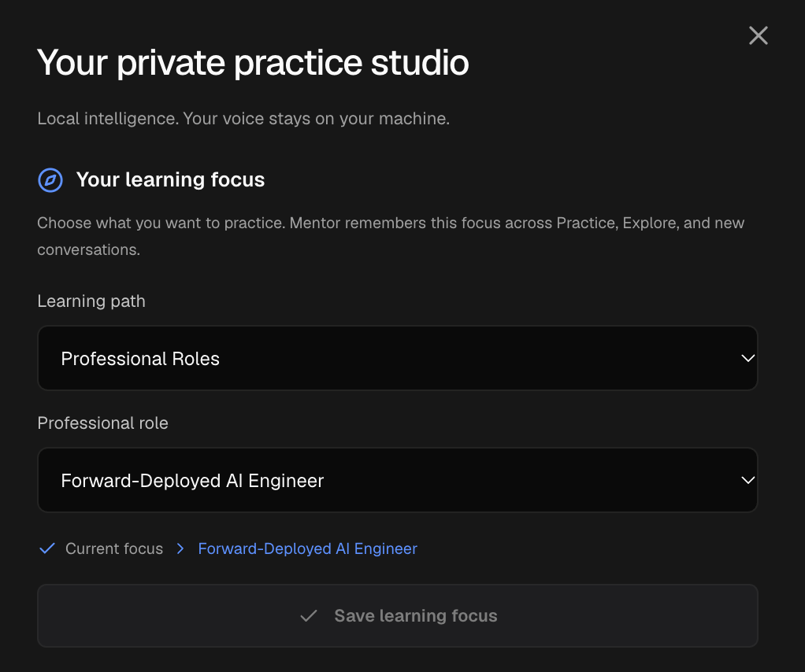
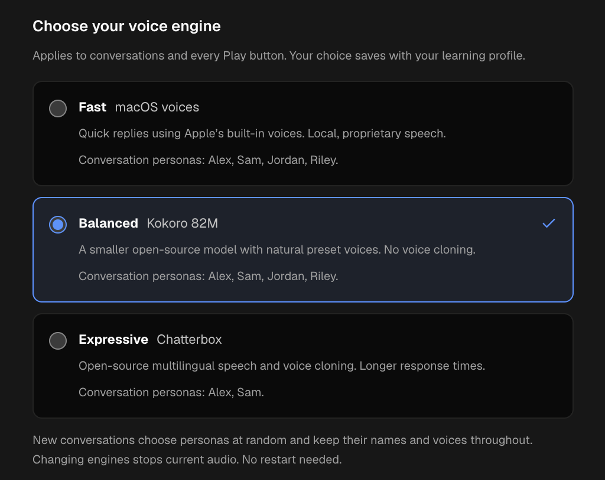
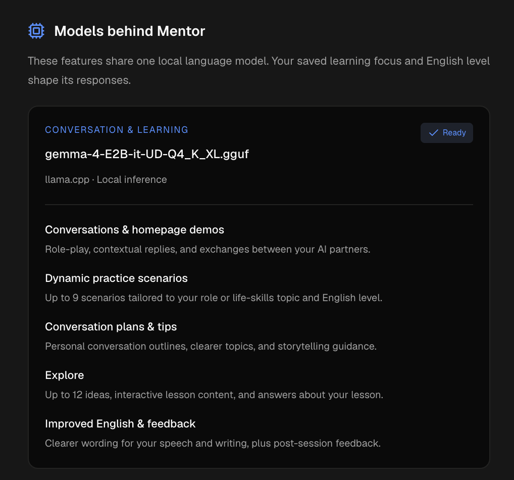
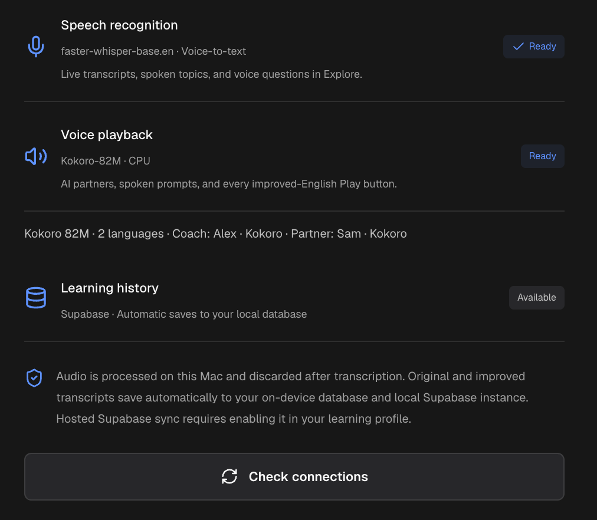

<p align="center">
  
</p>

# Configure your private practice studio

[Product overview](README.md) · **App configuration** · [Local SLM setup](README-SLM.md)

Set what you want to learn, choose the voice you hear, and check the local services behind Mentor. This guide follows the four Settings screenshots below. Model names, available voices, and connection status reflect the setup shown; your installation may report different values.

## Table of contents

- [Open Settings](#open-settings)
- [Choose your learning focus](#choose-your-learning-focus)
- [Choose your voice engine](#choose-your-voice-engine)
- [Understand the models behind Mentor](#understand-the-models-behind-mentor)
- [Check speech and learning history](#check-speech-and-learning-history)
- [Put your settings into practice](#put-your-settings-into-practice)
- [Troubleshooting](#troubleshooting)
- [Related documentation](#related-documentation)

## Open Settings

Complete the [local installation](README.md#run-locally) first. The [SLM setup guide](README-SLM.md) covers the Gemma download, llama.cpp installation, speech setup, and service tests. From the project directory, start the configured app and services:

```bash
npm run dev:local
```

Open **http://127.0.0.1:3000**, then choose **Settings** in the sidebar. On mobile, open the navigation menu first. The panel is titled **Your private practice studio**. Service status refreshes when you open it; **Check connections** refreshes it again.

Use **Learning profile** in the sidebar to set your English level, daily practice goal, and hosted-sync preference. Settings contains the learning focus and voice-engine controls shown below.

## Choose your learning focus



Your focus makes new practice and exploration relevant to you.

1. Choose a **Learning path**: **Professional Roles** or **Life & Workplace Skills**.
2. For professional practice, choose a **Professional role**. The screenshot uses **Forward-Deployed AI Engineer**. For life and workplace practice, choose a **Category** and **Topic**.
3. Select **Save learning focus**. The **Current focus** line shows the selection applied to your workspace.

The save button is disabled in the screenshot because the selected focus already matches the saved one. It also stays disabled while your profile is loading or a save is in progress. Changing an option enables it once the form is ready.

The saved focus carries across **Practice**, **Explore**, and new AI conversations. The selectors on the Practice homepage and Explore library update the same preference. New scenarios and exploration ideas use that focus together with your English level; existing sessions and saved lessons keep the context they started with.

To change difficulty, open **Learning profile**, choose **English level** from A2 through C2, and select **Save learning profile**. This changes vocabulary and conversation complexity. **Daily practice goal** sets the target shown on the homepage.

## Choose your voice engine



Select an available engine to save the choice immediately with your learning profile. This setting applies to AI conversations and spoken playback, including improved-English **Play** buttons. It has its own automatic save; **Save learning focus** applies only to your learning focus.

| Choice | What it changes | Personas shown in this setup |
| --- | --- | --- |
| **Fast — macOS voices** | Uses Apple's installed system voices for quick local replies. | Alex, Sam, Jordan, Riley |
| **Balanced — Kokoro 82M** | Uses a smaller neural model with preset voices. This is the default when no voice preference is saved. | Alex, Sam, Jordan, Riley |
| **Expressive — Chatterbox** | Uses multilingual speech with reference-based voice cloning, with longer response times. | Alex, Sam |

Available personas depend on the installed engine and voices. New conversations choose supported personas at random and keep their names and voices throughout the exchange. Switching engines stops current audio; switching between already available engines needs no service restart. If the new engine cannot voice an existing conversation's persona, start a new conversation or select a compatible engine.

An unavailable engine is disabled and shows setup guidance. Mentor does not silently substitute another engine. For installation commands and local reference-voice configuration, see [voice-engine setup](docs/local-models.md#voice-engine-selection).

## Understand the models behind Mentor



**Conversation & learning** identifies the loaded language model and its runtime. In this screenshot, it reports `gemma-4-E2B-it-UD-Q4_K_XL.gguf` through `llama.cpp`. This is a status display, not a model selector. To change the checkpoint or runtime, follow the [local model configuration guide](docs/local-models.md#configuration).

One local language model powers these features:

| Feature | How you use it |
| --- | --- |
| **Conversations & homepage demos** | Listen to AI partners, join their exchange, or rehearse a role-play. |
| **Dynamic practice scenarios** | Get up to nine situations tailored to your focus and English level. |
| **Conversation plans & tips** | Turn your own topic into a practice outline or clearer starting point. |
| **Explore** | Get up to twelve exploration ideas, create interactive lessons, and discuss a selected lesson. |
| **Improved English & feedback** | Compare your original wording with clearer English and review completed practice. |

**Ready** means the coach service reports availability without a degraded status. **Needs attention** and **Not connected** appear with relevant details when a problem is detected. **Model name not reported** means the service did not supply a checkpoint name; Mentor does not guess one from an API alias.

The language model, speech recognition, and voice playback are separate parts of the app. Changing your voice engine changes the spoken output, while the configured language model continues to generate the conversation and learning content.

## Check speech and learning history



Use **Check connections** after starting or repairing a local service. Read each row separately:

| Row | What it tells you |
| --- | --- |
| **Speech recognition** | Whether local voice-to-text is ready for transcripts, spoken topics, and Explore questions. The screenshot reports `faster-whisper-base.en`. |
| **Voice playback** | Whether your selected engine can synthesize speech. The screenshot reports `Kokoro-82M · CPU`. Recognition can be ready even when playback is unavailable. |
| **Voice details** | The selected service's reported language count and voice information. The screenshot's two-language label describes playback support, not the language of every learning feature. |
| **Learning history** | Where learning storage is configured. **Available** indicates Supabase configuration is present; it does not confirm a successful database read or save. Without Supabase configuration, the row shows on-device storage. |

Audio is processed locally and discarded. Original and improved practice transcripts save automatically to the on-device database and configured local Supabase. A sync failure keeps the local practice copy and displays a retry or error state.

Hosted Supabase sync requires explicit opt-in: configure a hosted project, open **Learning profile**, uncheck **Keep my learning data on this device**, and save the profile. That checkbox governs hosted uploads; configured loopback Supabase saves automatically. Model inference remains restricted to the local machine.

**Explore requires a configured, authorized learning database** for lessons, conversations, revisions, and saved controls. Its persistence is distinct from the on-device practice recovery copy. See the [database guide](supabase/README.md) for setup and access details. Use **Backup & reset → Download backup** to export your learning data before clearing browser storage or resetting practice.

## Put your settings into practice

1. Save your focus in **Settings** and your English level in **Learning profile**.
2. Return to **Practice**. Wait for the complete scenario batch to load; the homepage AI partners then start automatically when browser playback is allowed. Choose **Enable voice** if prompted.
3. Listen with your microphone off, or turn on **Your mic** to join. Choose **Start voice practice** or a scenario card for a focused session. Allow microphone access when you want to speak.
4. Compare your original words with **You, refined**. Pause a live conversation before playing an improved version aloud. Review saved practice in **Session history** and **My progress**.
5. Open **Explore** to speak or type a question. Select **Refine prompt**, review the three choices, and choose **Explore with this prompt**. Inspect the lesson, ask follow-up questions, or practice your own wording.

The [product tour](README.md#see-mentor-in-action) shows Practice and the full GitHub rebase exploration. For detailed playback, saving, backup, and restore behavior, see the [product guide](docs/product-guide.md).

## Troubleshooting

| What you see | What to do |
| --- | --- |
| **Save learning focus** is disabled | Change a selection first, or wait for profile loading/saving to finish. The current saved choice needs no additional save. |
| AI partners have not started | Wait for scenarios to finish. If scenario generation failed, use its retry control. If playback is blocked, choose **Enable voice**; if the conversation is paused, choose **Continue conversation**. |
| Coach or speech shows **Not connected** | Run `npm run dev:local` from the project directory, then choose **Check connections**. Inspect service details if startup reports an error. |
| A voice engine is unavailable | Run the setup command displayed for that engine. Kokoro uses `npm run speech:setup:kokoro`; Chatterbox uses `npm run speech:setup:chatterbox`. After installing new dependencies, restart the speech service you launched and check again. |
| The microphone does not transcribe | Allow microphone access for `127.0.0.1`, turn on the mic, and check **Speech recognition** separately from voice playback. |
| History saves or Explore fail despite **Available** | For local Supabase, make sure Docker is running, then run `npm run db:start`. For hosted Supabase, check your profile's sync opt-in and the [database configuration](supabase/README.md). Check the reported save/access error; restart the app if database configuration changed after launch. |

First-time recognition and default voice installation uses `npm run speech:setup`. Follow [SLM setup and tests](README-SLM.md) for the exact Gemma download and local inference commands. Additional runtime paths, alternative model choices, and speech details are covered in [local models](docs/local-models.md).

## Related documentation

- [README.md — product pitch, screenshots, architecture, and installation](README.md)
- [README-SLM.md — model download, runtime installation, configuration, and tests](README-SLM.md)
- [Product guide — complete interaction and data-management behavior](docs/product-guide.md)
- [Local models — speech engines, coach runtimes, and troubleshooting](docs/local-models.md)
- [Database guide — local Supabase, hosted opt-in, and Explore storage](supabase/README.md)
