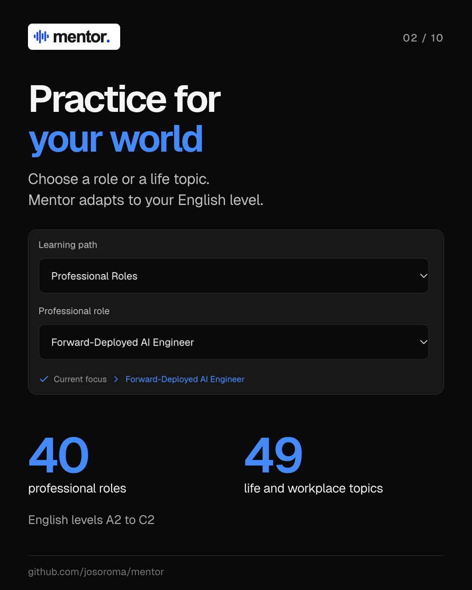
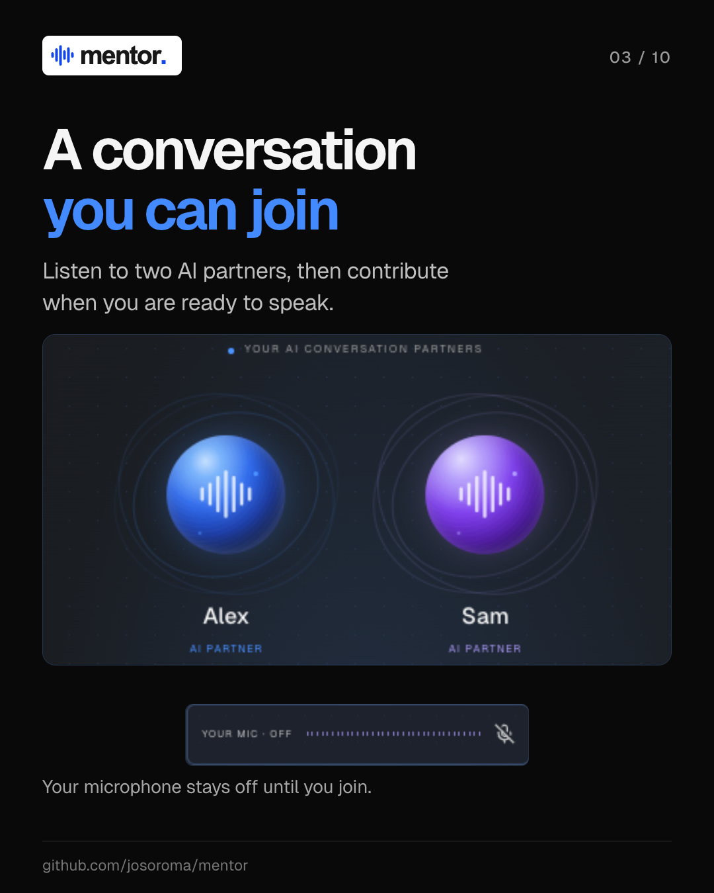
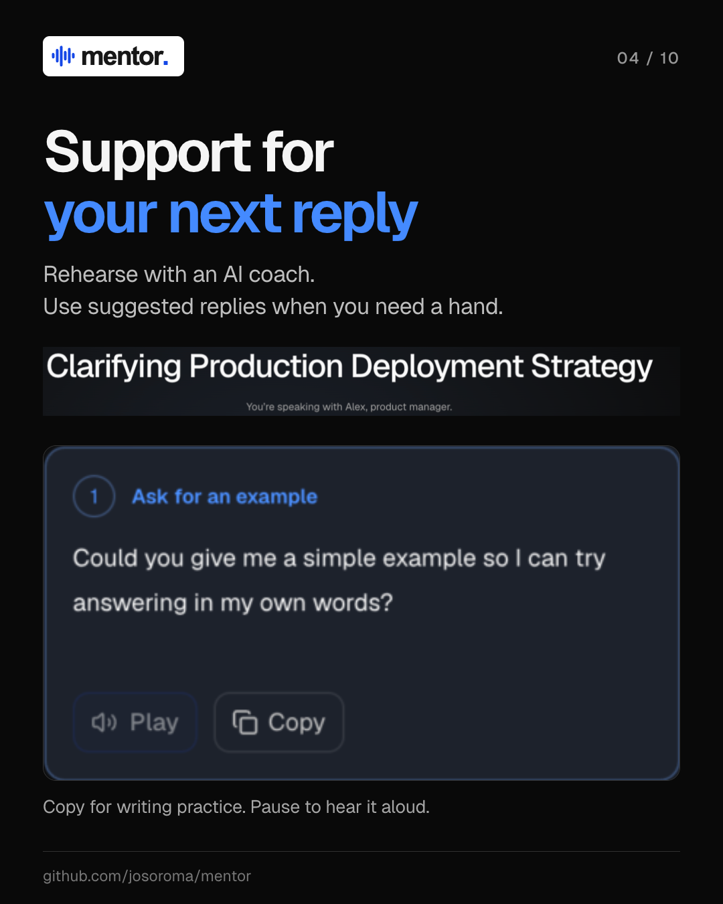
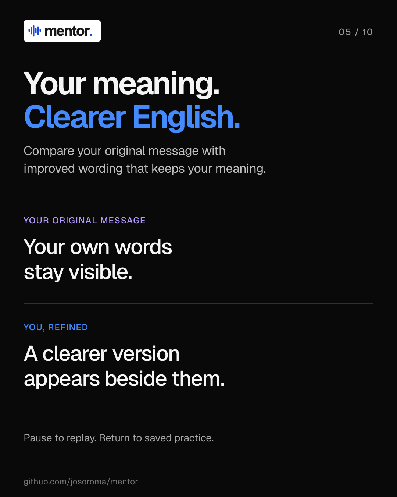
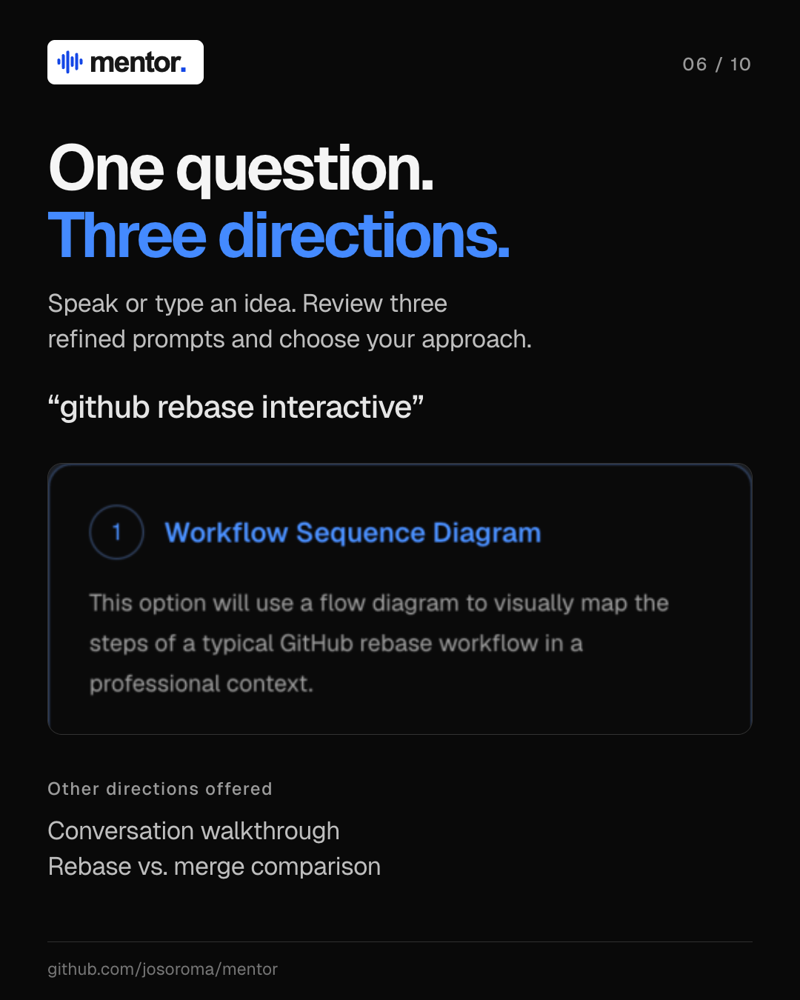
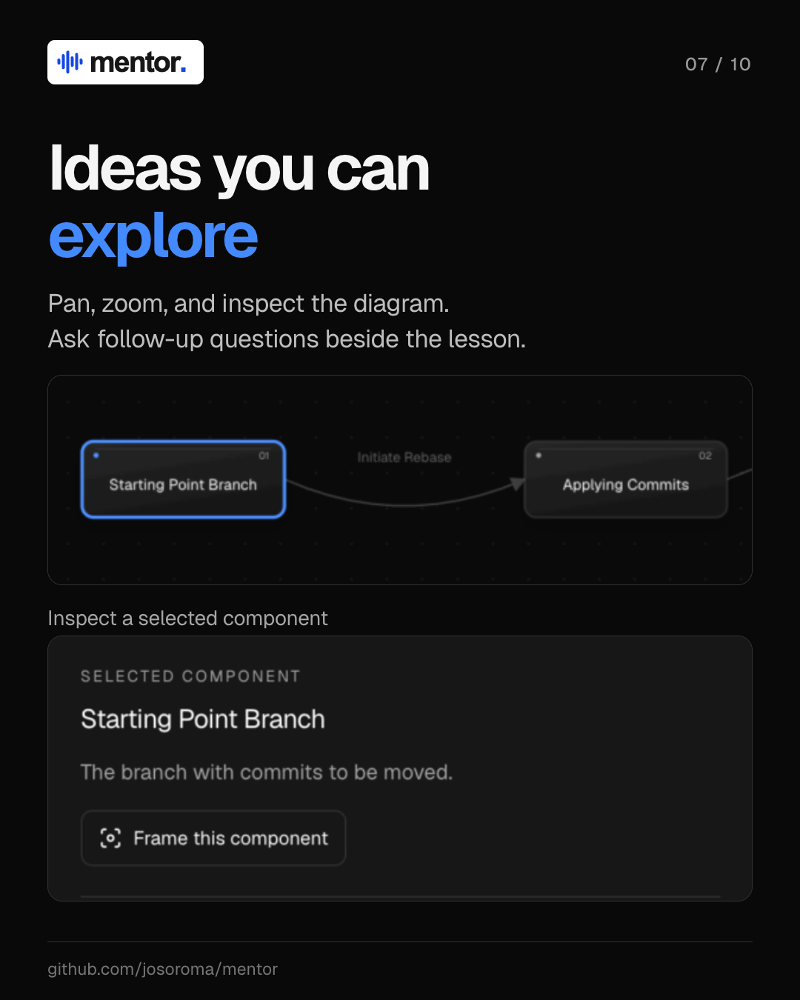
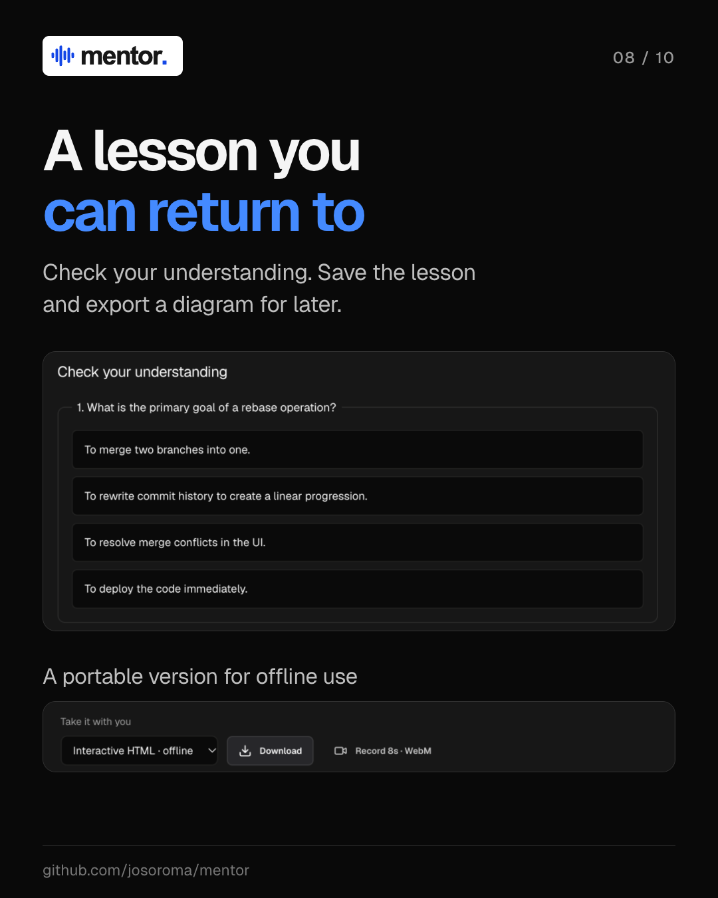
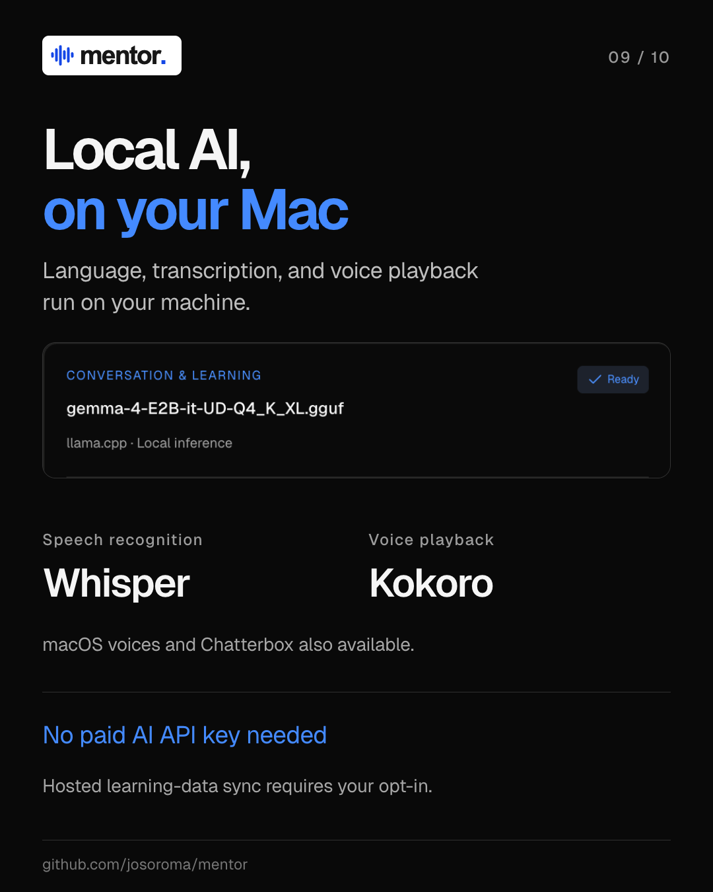
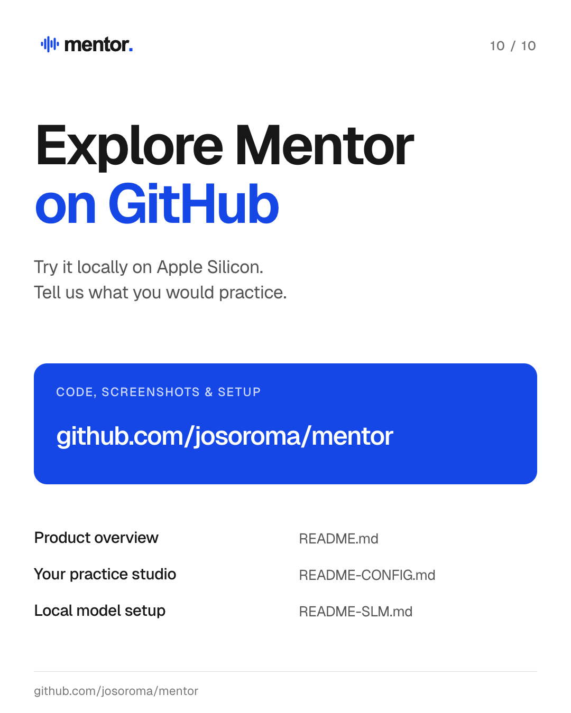

  

# Mentor LinkedIn carousel

[Product overview](README.md) · [App configuration](README-CONFIG.md) · [Local SLM setup](README-SLM.md) · **LinkedIn carousel**

Ten slides introduce Mentor's core features using the project's logo, colors, typography, and product screenshots. Each image is a **1080 × 1350 PNG** in [`docs/slides`](docs/slides/), numbered in carousel order.

## Table of contents

- [01. Meet Mentor](#01-meet-mentor)
- [02. Personalized practice](#02-personalized-practice)
- [03. AI conversation partners](#03-ai-conversation-partners)
- [04. Support for your next reply](#04-support-for-your-next-reply)
- [05. Clearer English](#05-clearer-english)
- [06. Three ways to explore](#06-three-ways-to-explore)
- [07. Interactive lessons](#07-interactive-lessons)
- [08. Save and revisit](#08-save-and-revisit)
- [09. Local AI](#09-local-ai)
- [10. Visit GitHub](#10-visit-github)
- [Related documentation](#related-documentation)

## 01. Meet Mentor

Mentor helps professionals practice the English conversations they need at work. The opening slide introduces voice practice and interactive learning powered by local AI.

## 02. Personalized practice

Choose a professional role or life topic, then set your English level. Mentor supports 40 professional roles, 49 life and workplace topics, and levels A2 through C2.

## 03. AI conversation partners

Listen to two AI partners before contributing to the exchange. Your microphone stays off until you choose to join.

## 04. Support for your next reply

Suggested replies help you continue a practice conversation. Adapt one in your own words, copy it for writing practice, or pause the conversation to hear it aloud.

## 05. Clearer English

Your original words remain visible alongside improved wording. Compare the versions, pause to replay an improvement, and return to saved practice later.

## 06. Three ways to explore

Speak or type a question and review three refined prompts. This GitHub rebase example offers a workflow diagram, a conversation walkthrough, or a comparison with merging.

## 07. Interactive lessons

Explore an explanation by inspecting its diagram components, panning, and zooming. Ask follow-up questions beside the lesson to discuss what you see.

## 08. Save and revisit

Check your understanding with lesson questions and revisit explorations saved to your configured learning database. Export a diagram as a portable interactive HTML file for offline use.

## 09. Local AI

Gemma handles language, Whisper transcribes speech, and Kokoro provides the default voice playback on your Mac. Model inference stays local; hosted learning-data sync requires your opt-in.

## 10. Visit GitHub

Explore the code, screenshots, and setup guides at [github.com/josoroma/mentor](https://github.com/josoroma/mentor). Try Mentor locally on Apple Silicon and share what you would like to practice.

## Related documentation

- [README.md — product pitch, screenshots, interaction flows, and stack](README.md)
- [README-CONFIG.md — learning focus, voice engines, model status, and privacy](README-CONFIG.md)
- [README-SLM.md — model download, runtime installation, configuration, and tests](README-SLM.md)
