<p align="center">
  
</p>

<h1 align="center">Your expertise deserves a clearer voice.</h1>

<p align="center">
  An AI English coach for the conversations that move your career forward.<br />
  Practice aloud. Explore ideas. Learn to express what you know.
</p>

<p align="center">
  <strong>Voice first · Personalized practice · Local AI · Interactive learning</strong>
</p>

**Product overview** · [App configuration](README-CONFIG.md) · [Local SLM setup](README-SLM.md)

## Table of contents

- [The pitch](#the-pitch)
- [See Mentor in action](#see-mentor-in-action)
- [How learning happens](#how-learning-happens)
- [Why this product](#why-this-product)
- [Stack and architecture](#stack-and-architecture)
- [What works today](#what-works-today)
- [Run locally](#run-locally)
- [Development and documentation](#development-and-documentation)

## The pitch

**Mentor helps people who know their work communicate it in English.** A developer can rehearse a customer conversation, a team lead can practice difficult feedback, and a learner can explore an unfamiliar concept before explaining it aloud. The AI adapts to their role, topic, and English level, then shows clearer wording alongside what they actually said.

The problem is the gap between knowing English and using it when it matters: explaining a decision, asking a precise question, handling disagreement, or presenting an idea. Mentor makes those situations available for repeated practice in a personal workspace.

The initial focus is professionals working in English, especially technical and customer-facing roles. The product already supports **40 professional roles** and **49 life and workplace topics across 14 categories**, with English levels from **A2 through C2**.

The ambition is a daily learning companion that connects understanding a subject with communicating it well. **Practice** builds the conversation; **Explore** builds the understanding. Both preserve the learner's original words and offer improved English.

## See Mentor in action

Screenshots show Mentor's local app, including a GitHub rebase exploration.

### A homepage you can join

Choose a learning focus. Mentor first loads the complete batch of personalized scenarios, then automatically starts two AI conversation partners when browser playback allows it. Listen with your microphone off, or turn it on and join the same exchange. If autoplay needs a gesture, choose **Enable voice** once.

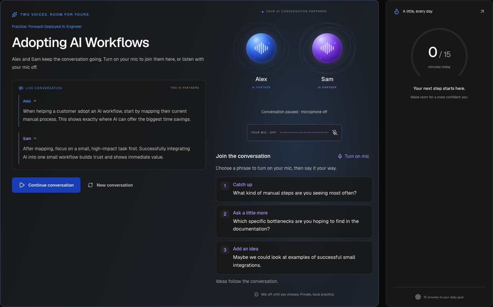

*The partners share a conversation tied to your selected focus. Your microphone stays off until you choose to join.*

### Rehearse a situation that matters

Generated scenarios include a situation, conversation partner, opening question, and practice objectives. Start directly, inspect a scenario first, or save it with the heart to revisit later. A separate free-conversation flow lets you bring your own topic.

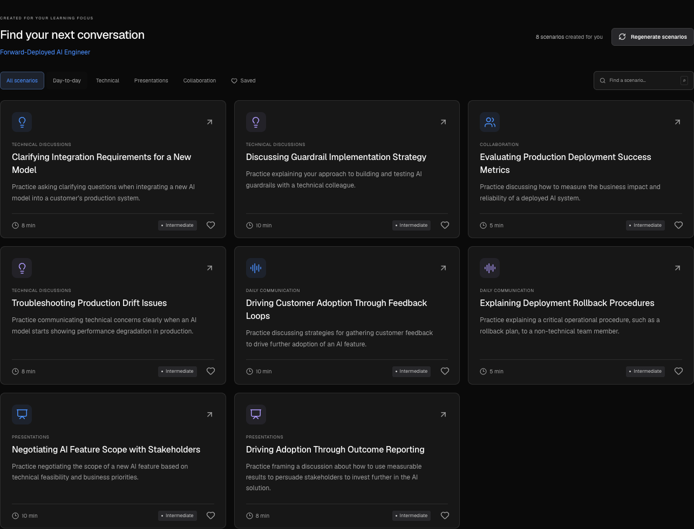

*Scenario generation follows your learning focus and English level. The partners wait while scenarios load; failed generation has a retry path.*

### Practice the conversation aloud

In **Practice**, a Forward-Deployed AI Engineer rehearses **Clarifying Production Deployment Strategy** with Alex, the AI coach playing a product manager. Suggested replies help the learner find their next words: adapt one aloud, copy it for writing practice, or pause the conversation and press **Play** to hear it.

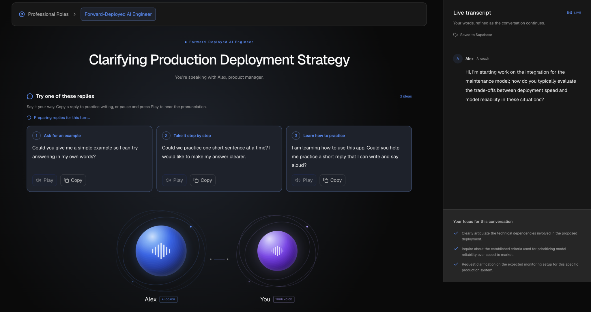

*Follow the live transcript and conversation goals while practicing. Suggested replies offer support when you need help continuing.*

### Turn curiosity into a lesson

In **Explore**, speak or type a question, review three refined prompts, and choose the one you want to explore. Here, **“github rebase interactive”** becomes three directions: a workflow diagram, a workplace conversation, and a rebase-versus-merge comparison.

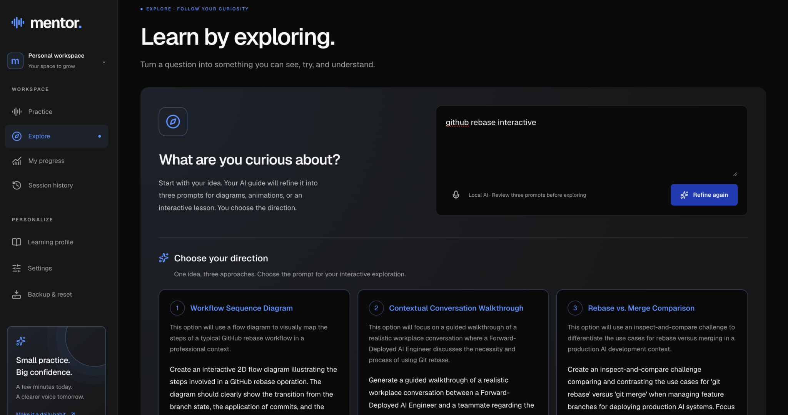

*Start with your question. Choose how you want to learn.*

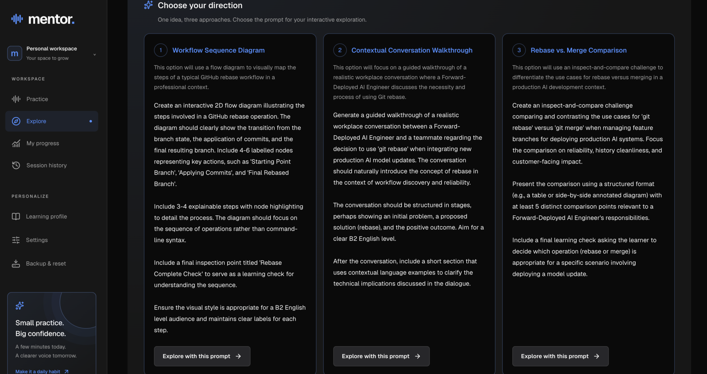

*Review the complete prompts before choosing **Explore with this prompt**.*

<details>
<summary>From a chosen prompt to a lesson</summary>

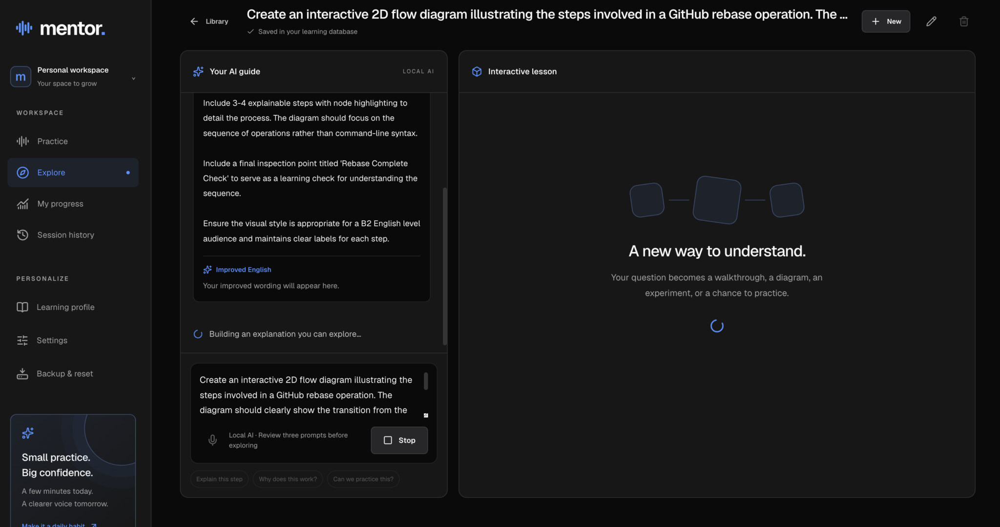

*Mentor shows generation progress while it builds the explanation.*

</details>

### Learn with something you can manipulate

The selected prompt becomes an interactive GitHub rebase workflow. Inspect its components, pan and zoom the diagram, and ask follow-up questions beside the lesson. Saved controls let you return to the same exploration.

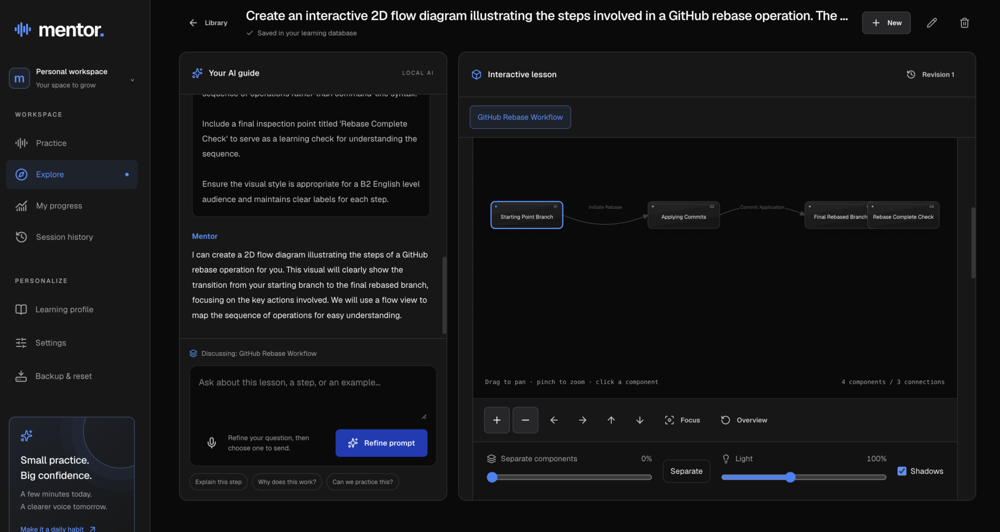

*Move from a question to a visual explanation you can inspect. Follow-up questions discuss this lesson; a new exploration creates a separate one.*

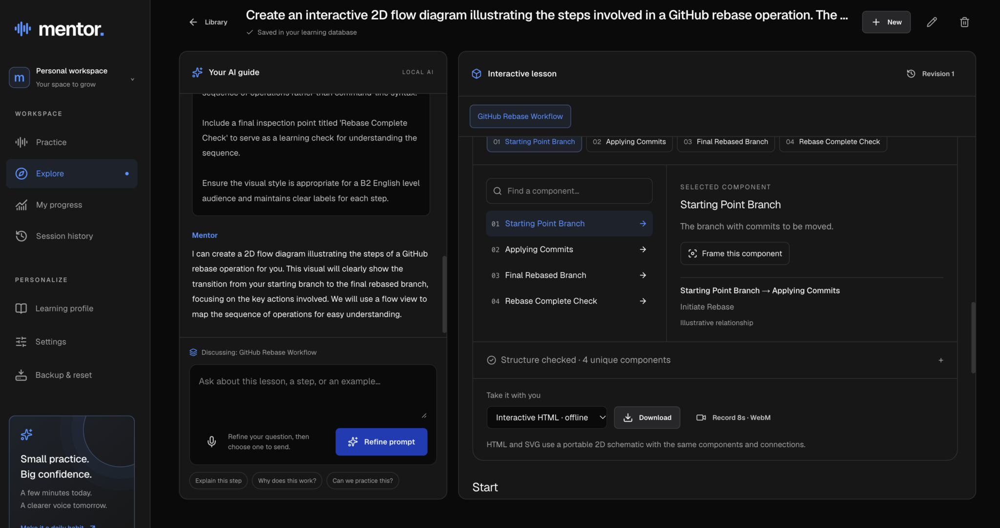

*Inspect a component and its connections, then download an interactive HTML version for offline use.*

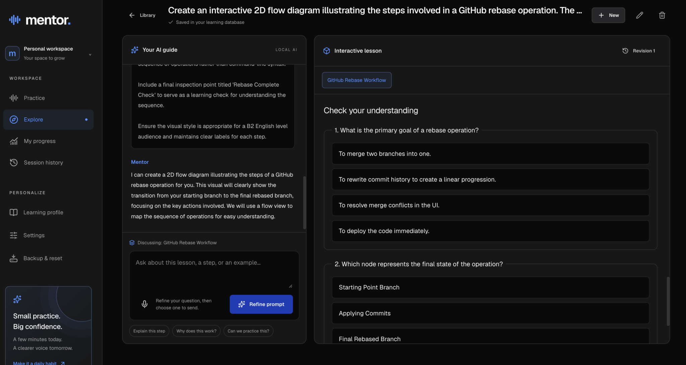

*Check your understanding with questions tied to the lesson.*

## How learning happens

### From listening to speaking

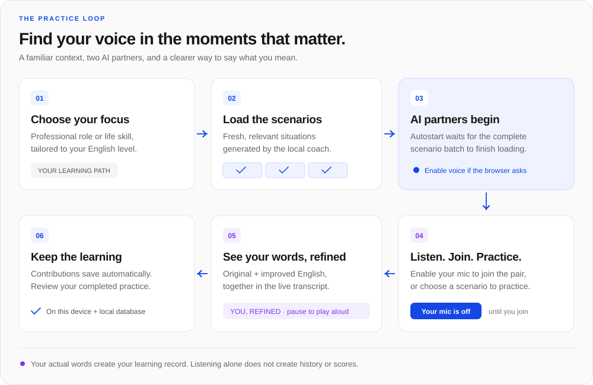

1. **Make it relevant.** Pick a professional role or life-skills topic and an English level. The full scenario batch loads before the homepage partners start.
2. **Find your way into the conversation.** Listen first, use a suggested opening, or interrupt with your own contribution. Selecting a suggestion never records it as something you said.
3. **See your words become clearer.** Live practice shows **You, refined** beneath your original message. Pause to hear the improved version with a local voice.
4. **Keep the evidence of learning.** Original and improved transcripts save automatically. Completed practice can receive feedback grounded in the learner's actual words; history and progress support the next session.

### From a question to understanding

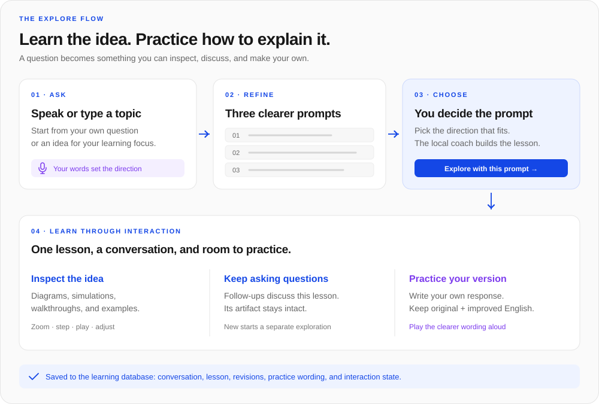

Explore combines subject learning with English practice. Its built-in executable models cover examples such as sorting, Fibonacci, Hanoi, Planning Poker, pendulums, waves, and orbits. Other topics use structured explanations, examples, and diagrams. Diagram controls include 2D/3D views, zoom, pan, component focus, separation, and chapter playback.

Lessons and their conversations save to the configured learning database. Diagram exports include SVG, PNG, a sharing card, and a self-contained interactive HTML file. The renderer accepts validated declarative data; it never runs model-generated JavaScript, HTML, or shaders.

## Why this product

| Product choice | Value to the learner |
| --- | --- |
| Practice for a specific role or situation | Rehearse the vocabulary and decisions you need in real conversations. |
| Two AI partners with an optional microphone | Listen before joining, then contribute without switching to another screen. |
| Original and improved English side by side | Compare your own wording with a clearer version while preserving your meaning. |
| Conversation and interactive lessons in one workspace | Understand a concept and practice explaining it in the same place. |
| Local inference and durable learning records | Keep model requests on your machine and return to saved transcripts and lessons. |

**The business hypothesis:** begin with individual professionals who repeatedly need to communicate in English, then test employer-sponsored learning for teams. Paid individual plans and team seats are possible business models to validate; this repository demonstrates the product, with commercial validation still ahead.

The next product questions are concrete: do learners return for another conversation, do they reuse improved wording, and does role-specific practice help them prepare for real situations? The current implementation provides the practice and review loop; those outcomes still need user validation.

## Stack and architecture

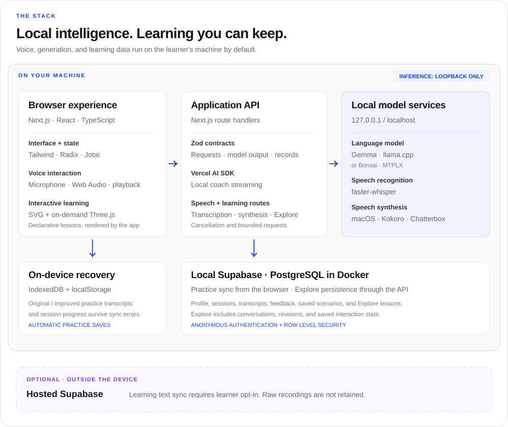

| Layer | Technology in this repository | Responsibility |
| --- | --- | --- |
| Application | Next.js 16 App Router, React 19, TypeScript 5 | Workspace, route handlers, and streamed interactions |
| Interface | Tailwind CSS 4, CSS Modules, Radix primitives, Lucide icons, Geist | Responsive light/dark UI, accessible controls, and the Mentor visual language |
| State and contracts | Jotai, Zod 4, React Hook Form | Saved preferences, validated forms, API and model boundaries |
| Local coach | Vercel AI SDK 7, `@ai-sdk/openai`, llama.cpp with cached Gemma; MTPLX/Bonsai alternative | Conversation, scenario generation, prompt refinement, lessons, rewrites, and feedback via local Chat Completions |
| Speech recognition | Browser microphone/Web Audio, Python, faster-whisper | Local transcription with CPU int8 inference and silence filtering |
| Voice playback | Kokoro-82M by default; macOS voices or Chatterbox available | Local WAV synthesis, selected personas, cancellation, and audio-reactive visuals |
| Interactive lessons | Three.js, SVG, typed model renderers | Spatial diagrams, deterministic supported simulations, playback, and exports |
| Learning data | IndexedDB, localStorage recovery, Supabase/PostgreSQL in Docker | Practice recovery, authenticated storage with row-level security, Explore sessions and revision history |
| Validation | Vitest, Playwright, TypeScript, local speech/API smoke scripts | Domain, storage, lifecycle, UI, and real-service checks |

**The privacy boundary is explicit.** Inference endpoints must be loopback addresses. Raw recordings are processed locally and discarded. Practice transcripts save on device and automatically to configured local Supabase. Hosted Supabase text uploads require the learner's opt-in; sync failures preserve the local practice copy. Explore needs the configured, authorized learning database. Model downloads happen during setup; there is no silent hosted-model fallback.

The OpenAI-compatible adapter is a protocol connection to local runtimes. Running Mentor does not require a paid AI API key.

## What works today

This repository contains a working local application, with voice practice, generated scenarios, two-partner homepage conversations, live wording improvements, session review, progress, bookmarks, interactive Explore lessons, and backup/restore. It is built around an Apple Silicon Mac and local services. A public hosted product, self-serve onboarding, cross-device account recovery, and commercial traction are not established here.

Feedback is based on transcripts. Pronunciation, acoustic fluency, and vocal confidence are **not scored**; coaching estimates are not a standardized proficiency assessment. Generated explanations can contain mistakes. Speech is turn-based, and response time depends on local hardware, model, and lesson size. Unavailable services produce visible errors with retry controls.

## Run locally

The supported setup uses **Node.js 22+**, an **Apple Silicon Mac**, `uv`, `ffmpeg`, Docker, the Supabase CLI, and an installed compatible coach model/runtime. Follow the [local SLM setup](README-SLM.md) to install llama.cpp, download the exact Gemma checkpoint, configure inference, and test the local services before launching.

```bash
npm install
cp .env.example .env.local
npm run speech:setup
npm run dev:local
```

`speech:setup` installs recognition and the default Kokoro voice engine. `dev:local` configures local Supabase, applies migrations, and starts or reuses the local coach, speech service, and app. Open **http://127.0.0.1:3000**; local Database Studio is at **http://127.0.0.1:54323**.

Follow the [screenshot-based configuration guide](README-CONFIG.md) to choose your learning focus, English level, and voice engine. Wait for scenarios to load, then listen to the partners or start a practice session. Use **Settings → Check connections** to inspect model readiness. Explore requires the coach and learning database. Optional expressive speech setup is available with `npm run speech:setup:chatterbox`.

Ctrl-C stops only app/model processes started by the launcher. To stop local Supabase while retaining its data, run `npm run db:stop`. A remote Next.js deployment alone cannot reach models on your laptop.

## Development and documentation

```bash
npm run typecheck
npm test
npm run build
```

Real voice checks need the local services; see [SLM installation tests](README-SLM.md#test-the-installation) and the [detailed model guide](docs/local-models.md). To run the production build on the same machine, use `npm start` with the coach and speech services running.

| Read more | Contents |
| --- | --- |
| [Configuration guide](README-CONFIG.md) | Settings screenshots, learning focus, voice engines, model status, privacy, and connection checks |
| [Local SLM setup](README-SLM.md) | Exact Gemma download, checksum, llama.cpp installation, local configuration, and real-service test commands |
| [Product guide](docs/product-guide.md) | Detailed interaction behavior, voice engines, learning paths, Explore, backup, restore, and reset |
| [Local models](docs/local-models.md) | Installation, runtime selection, service checks, latency, and troubleshooting |
| [Database guide](supabase/README.md) | Local Supabase, ownership, row-level security, synchronization, and Explore persistence |
| [Repository conventions](AGENTS.md) | Code style, module boundaries, local-only inference, and required validation |

Core code lives in [`app/_components/`](app/_components/), [`app/_hooks/`](app/_hooks/), [`app/api/`](app/api/), and [`lib/`](lib/). The SVG diagrams and screenshots above are stored in this repository so the product story travels with the code.
